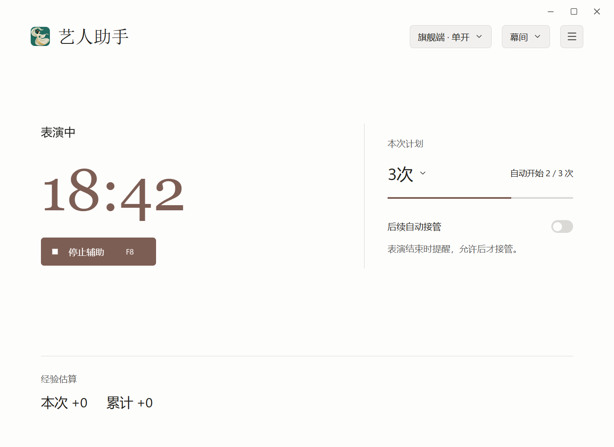
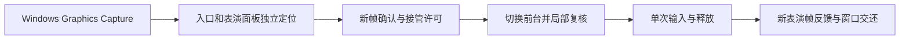

# 剑网3 艺人助手

面向《剑网3》PC 旗舰端单开的 Windows 桌面助手。自动开始表演，观察艺人表演状态，在表演结束后按计划续演。

[下载 Release](https://github.com/Ciderrr/jx3Art/releases) · [更新公告](CHANGELOG.md) · [使用步骤](#使用步骤) · [功能介绍](#功能介绍) · [反馈](#反馈)

## 下载与安装

| 版本 | 适合谁 | 下载后怎么做 |
| --- | --- | --- |
| **安装版** | 希望以后从开始菜单打开，或在原目录升级 | 双击安装程序，按向导安装。默认创建桌面快捷方式，可取消。安装后也可双击目录中的 `艺人助手.exe`。 [下载 Setup.exe](https://github.com/Ciderrr/jx3Art/releases/download/v1.0.1/JX3Artist-1.0.1-Setup.exe) |
| **便携版** | 希望自己选文件夹，保留旧版目录 | 完整解压 ZIP，双击 `JX3Artist.exe`。 [下载 Windows ZIP](https://github.com/Ciderrr/jx3Art/releases/download/v1.0.1/JX3Artist-1.0.1-win-x64.zip) |

适用于 Windows 11 x64。两个版本都已内置 .NET 和图像识别环境。首次打开按 Windows 提示授权。若缺少用于显示界面的 WebView2，可在提示窗口一键安装或打开微软官网。

更新时，在**设置 → 关于与反馈 → 检查更新**中操作。先停止辅助，再点击**下载并更新**。安装版在原目录升级，便携版解压到新版目录后打开，设置和经验继续使用同一数据目录。已安装早期 v1.0.1 的用户可下载修订版覆盖安装。

[查看安装界面示例](docs/images/setup.png) · [v1.0.1 发行说明](https://github.com/Ciderrr/jx3Art/releases/tag/v1.0.1) · [更新公告](CHANGELOG.md)

## 使用步骤

1. 把角色放在安全、平整的位置，避开主城公示牌旁边。
2. 在江湖百态中打开艺人，保持开始表演图标可见。
3. 打开助手，选择本次表演计划。可选指定次数或持续运行。
4. 如果希望每轮结束后自动续演，开启**后续自动接管**。开启后，续演时助手会短暂切回游戏并移动鼠标。
5. 点击**开始辅助**，或按默认快捷键 **F7**。需要停止时，点击**停止辅助**或按 **F8**。

## 功能介绍

- **按计划续演。** 开启自动接管时，表演结束后按计划尝试续演。关闭时会提醒，等你确认后再接管。
- **随时停止。** 停止的是后续辅助操作，游戏内已经开始的表演继续进行。
- **倒计时与经验估算。** 显示已确认的倒计时，根据连续有效的观察区间估算本次和累计经验。设置中可单独清零累计。
- **个性化。** 支持主题、内置或本地图标、快捷键，以及从设置创建桌面快捷方式。

## 技术设计

项目的工程重点是把图像证据、输入许可和执行反馈接成一条可核查的链路。

- **有界的全局模板搜索。** OpenCV 归一化互相关按输出位置分块，输入保留模板大小的重叠区域。分块结果回填全局分数图，统一去重并判断唯一性。并行路径最多保留两个未消费块，限制临时结果积压。入口与面板分别定位，各自核对尺寸和位置。 [定位与匹配源码](int1/calibration/location_guard.py) · [窗口定位源码](int1/calibration/portable_locator.py)
- **把完整识别放在切换前。** 先从两张新帧确认入口，切换后用局部新帧复核。实际输入前还检查窗口身份、几何、前台、键鼠状态、源帧时效及取消状态。输入释放后用两张不同的新表演帧确认结果。置前失败可在原授权期限内重新观察并有限重试。 [输入与接管源码](product/JX3Artist/AutomationService.cs) · [前台事务](product/JX3Artist/FocusTransaction.cs)
- **倒计时可降级。** 识别器根据时钟和字形位置找文字区域，由 Windows OCR 多次读取。读数冲突保留未知，观察调度转入有界检查。续演仍依据当前入口的重新确认。 [倒计时读取](product/JX3Artist/CountdownReader.cs) · [调度源码](product/JX3Artist/CountdownTracker.cs)
- **本地界面与诊断。** WPF 宿主通过 WebView2 加载本地 React 界面，前端只能调用约定的操作。问题报告在本地预览后由用户保存，导出使用字段白名单。 [界面桥接](product/JX3Artist/WebUiProtocol.cs) · [问题报告](product/JX3Artist/SupportReport.cs)

## 实测范围

| 项目 | 已有证据 |
| --- | --- |
| 本机旗舰端单开 | 0.1.77 在 3840×2160、DPI 144 的一次正常使用中连续运行 2 小时 7 分 33 秒，四次自然续演均完成表演确认与窗口交还 |
| 前台操作时间 | 该次运行的五次启动中，从确认游戏前台到点击约 80～89 毫秒。整个识别和接管流程另有耗时 |
| v1.0 发行检查 | 351 项程序检查、21 项隔离界面联调、12 种主题离屏渲染。安装器在本机隔离目录验证安装、覆盖安装与卸载 |
| 待验证 | 真实置前失败后的重试、原生 1280、跨机和多种窗口布局、实际经验到账精度 |

该次正常使用前还有一次客户端定位失败。正式挂机的首次启动确认了表演，收尾时检测到前台和键鼠状态变化，保留当时的前台窗口。四次自动续演均确认交还。无界端和多开仍在规划中。

## 待更新计划

- 旗舰端多开。
- 无界端适配。
- 碰瓷奇遇功能，重复10轮，每轮包含开始表演和结束表演。

## 开发者入口

源码构建、依赖和识别模板清单集中在构建文档。 [构建与验证](docs/BUILD.md)

## 反馈

报告问题时可附版本、窗口尺寸、系统缩放、发生时间和问题码。助手的“记录与问题报告”菜单可预览和导出诊断包，便于核对接管和识别过程。 [提交 Issue](https://github.com/Ciderrr/jx3Art/issues)

## 许可证

项目自有源码使用 MIT 许可证。第三方组件保留各自的许可与声明，游戏素材独立处理。 [MIT 许可证](LICENSE) · [第三方说明](THIRD_PARTY_NOTICES.md)
