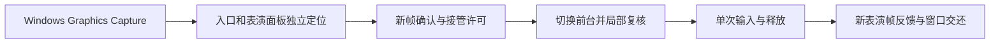

<p align="center"></p>

# 剑网3 艺人助手

面向《剑网3》PC 旗舰端单开的 Windows 桌面助手。观察艺人表演状态，在表演结束后按计划续演，也可以每次由你确认接管。项目独立维护，当前源码基线为 **0.1.77**。

[运行演示](#运行演示) · [使用方式](#使用方式) · [技术设计](#技术设计) · [实测范围](#实测范围) · [反馈](#反馈)


上图使用模拟表演数据。**首发提供源码和界面演示的构建方式。** 真实识别需要六个单独准备的兼容模板，本仓库暂不分发这些游戏裁剪素材，也不提供开箱即用的挂机包。 [构建与模板清单](docs/BUILD.md)

## 运行演示

在 Windows x64 上安装 .NET 10 SDK、Node.js 22.12 或更高版本，以及 Microsoft Edge WebView2 Runtime。演示使用独立的数据目录和模拟表演状态。

```powershell
git clone https://github.com/Ciderrr/jx3Art.git
Set-Location jx3Art
npm --prefix product/frontend ci --ignore-scripts
npm --prefix product/frontend run build
dotnet publish product/JX3Artist/JX3Artist.csproj -c Release -p:IncludeGameTemplates=false -o output/demo
```

双击 `output/demo/Preview.cmd`，或用下列命令启动。

```powershell
dotnet output/demo/JX3Artist.dll --demo --out output/demo-session
```

## 使用方式

以下流程适用于具备兼容模板及识别环境的完整构建。把角色放在安全、平坦的位置，在江湖百态中打开艺人并保持开始表演图标可见。选择本次计划后开始辅助，默认快捷键为 **F7 开始、F8 停止**，可以在设置中重新录入。

- **手动接管。** 表演结束时提示，确认后短暂切到游戏并移动鼠标执行操作。
- **自动接管。** 开启后续自动接管后，助手按计划尝试切回游戏并续演。切换受 Windows 前台规则约束，持续失败时暂停并显示问题码。
- **停止。** 停止后续辅助操作，游戏内已经开始的表演继续进行。
- **经验。** 根据连续有效观察区间估算本次和累计经验，设置中可单独清零累计。
- **个性化。** 支持主题、内置或本地图标，以及从设置创建桌面快捷方式。

## 技术设计

项目的工程重点是把图像证据、输入许可和执行反馈接成一条可核查的链路。



- **有界的全局模板搜索。** OpenCV 归一化互相关按输出位置分块，输入保留模板大小的重叠区域。分块结果回填全局分数图，统一去重并判断唯一性。并行路径最多保留两个未消费块，限制临时结果积压。入口与面板分别定位，各自核对尺寸和位置。 [定位与匹配源码](int1/calibration/location_guard.py) · [窗口定位源码](int1/calibration/portable_locator.py)
- **把完整识别放在切换前。** 先从两张新帧确认入口，切换后用局部新帧复核。实际输入前还检查窗口身份、几何、前台、键鼠状态、源帧时效及取消状态。输入释放后用两张不同的新表演帧确认结果。置前失败可在原授权期限内重新观察并有限重试。 [输入与接管源码](product/JX3Artist/AutomationService.cs) · [前台事务](product/JX3Artist/FocusTransaction.cs)
- **倒计时可降级。** 识别器根据时钟和字形位置找文字区域，由 Windows OCR 多次读取。读数冲突保留未知，观察调度转入有界检查。续演仍依据当前入口的重新确认。 [倒计时读取](product/JX3Artist/CountdownReader.cs) · [调度源码](product/JX3Artist/CountdownTracker.cs)
- **本地界面与诊断。** WPF 宿主通过 WebView2 加载本地 React 界面，前端只能调用约定的操作。问题报告在本地预览后由用户保存，导出使用字段白名单。 [界面桥接](product/JX3Artist/WebUiProtocol.cs) · [问题报告](product/JX3Artist/SupportReport.cs)

## 实测范围

| 项目 | 已有证据 |
| --- | --- |
| 本机旗舰端单开 | 0.1.77 在 3840×2160、DPI 144 的一次正常使用中连续运行 2 小时 7 分 33 秒，四次自然续演均完成表演确认与窗口交还 |
| 前台操作时间 | 该次运行的五次启动中，从确认游戏前台到点击约 80～89 毫秒。整个识别和接管流程另有耗时 |
| 界面演示 | 本公开源码快照独立构建通过，完成 21 项 WebView2 隔离联调和 12 种主题离屏渲染 |
| 待验证 | 真实置前失败后的重试、原生 1280、跨机和多种窗口布局、实际经验到账精度 |

该次正常使用前还有一次客户端定位失败。正式挂机的首次启动确认了表演，收尾时检测到前台和键鼠状态变化，保留当时的前台窗口。四次自动续演均确认交还。无界端和多开仍在规划中。

## 反馈

报告问题时可附版本、窗口尺寸、系统缩放、发生时间和问题码。助手的“记录与问题报告”菜单可预览和导出诊断包，便于核对接管和识别过程。 [提交 Issue](https://github.com/Ciderrr/jx3Art/issues)

## 许可证

项目自有源码使用 MIT 许可证。第三方组件保留各自的许可与声明，游戏素材独立处理。 [MIT 许可证](LICENSE) · [第三方说明](THIRD_PARTY_NOTICES.md)
